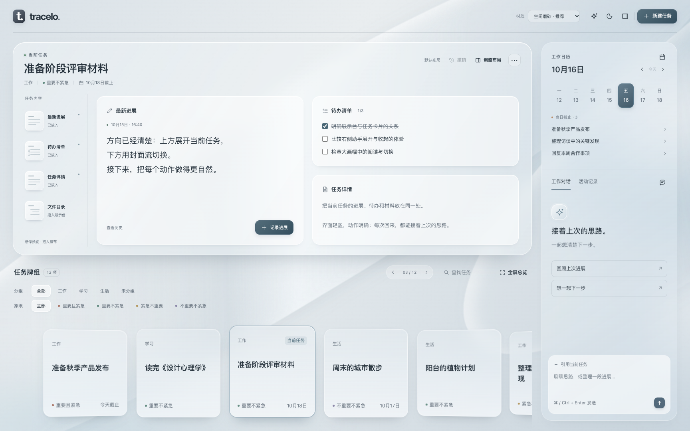
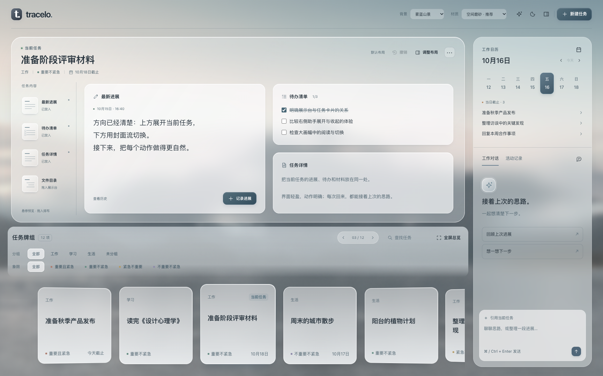

# 自由排布展示台 · 材质与交互提案

2026-10-16。基于用户圈图反馈及小红书五种玻璃风格，深化现有工作台。当前交付是独立可操作设计原型，未修改生产实现、正式任务或安装。

## 预览

在仓库根目录运行 `python3 -m http.server 4196 --bind 127.0.0.1 --directory docs/design/modular-stage`，打开 <http://127.0.0.1:4196/>。页顶“材质”可在空间磨砂、柔和磨砂、高透玻璃间切换，同一结构便于判断材质差异。浅／深色可用月亮按钮切换。

代表状态：`?state=arranging` 展开布局控制；`?state=three-columns` 展示目录第三列；`?state=empty-task` 空任务；`?state=long` 长内容；`?state=quadrants` 总览四象限；`?state=dark` 深色。材料比较：`?material=soft`、`?material=clear`。

## 已由用户明确的行为

- 展示台本身也是卡片，包含任务标题、操作和内容区；三点操作有明确归属。
- 左侧竖排小缩略图，右侧文字指明进展、待办、详情和目录。悬停预览；按住拖入右边才加入，点击不新增。
- 右侧按列／行放内容卡片。列间悬停出现加列，列内卡片之间悬停出现加行；显现不立即改变布局，点击或松开拖拽才执行。
- 新增列默认等宽，列内新增行默认等高，分界线可手动调整。
- 有默认布局；调整后归属于当前这张任务卡，其他未调整任务继续使用默认布局。切回任务恢复其布局。生产持久化应以稳定任务ID绑定，而不依赖名称。
- 分组与象限筛选统一视觉；移除任务／分组Emoji，保留操作图标。
- 下方任务卡片不再循环：每任务一张，首尾停止，方向按钮到边界禁用（2026-10-16 最新反馈覆盖此前循环要求）。

默认布局提案为左进展整列、右待办与详情两行；文件目录从左侧拖入，或在有材料目录时采用三列默认。后者与现行生产条件目录规则如何衔接，接入前需要明确。

## 材质判断（提案，未视为用户定稿）

已查看 [AI试毒员的小红书笔记](https://xhslink.cn/o/Mhw3TzgY9Q) 的五张图片。以下名称是该笔记的分类，并非统一行业标准。

| 笔记方向 | 用在本产品的判断 |
| --- | --- |
| 1 Skeuomorphic Glass | 建筑、植物、阳光和写实场景占主导，适合作品展示；日常工作台长时间使用不需要这类布景。 |
| 2 Spatial Glass | 推荐给展示台外壳、牌组和侧栏：清楚的前后距离、透过背景的中性色变化，符合桌面多面板。 |
| 3 Liquid Glass | 少量给选择、拖动落点等交互表层；大面积强反光／透镜边缘会和长文字争夺注意力。高透对照仅比较更低覆盖与更亮边缘，不宣称实现系统级光学折射。 |
| 4 Soft Glassmorphism | 推荐给进展、待办和详情阅读面：比外壳更稳定的浅色覆盖，文字清楚，又保留柔和透色。 |
| 5 Neumorphic Glass | 更偏柔软浮雕，凸起／凹陷强，透明感弱；会放大当前“灰白实心面板”的问题。 |

因此推荐“2的空间层次＋4的阅读面”，3只作为局部交互语言。按 [Apple材质指南](https://developer.apple.com/design/human-interface-guidelines/materials) 区分内容和导航／控件层，不把所有内容都改为Liquid Glass。Apple指南用于支持材质分层，具体组合是本轮设计判断。

当前原型让中性背景有可见的明暗折面，使透明度有参照；外壳低覆盖加整体模糊，内部卡片提高白色覆盖，不重复多层模糊。正文下不做高频闪光或纹理；阴影给出高度、单侧亮边给出受光，减少对粗白边的依赖。支持减少动效、减少透明和无模糊回退。

## 补充交互（本轮提案）

- 插入加号与分界线拖柄分开，避免误加行列。普通悬停只显现附近控制；“调整布局”可显现全部控制，键盘也可进入。
- 同类模块每个任务只保留一份；重复拖入移动已有模块。收回只移出展示区，内容与未提交草稿仍保留。
- 新增行只均分目标列的行高，其他列保持其比例；新增列重新等分列宽。已有比例可再次手调。空列自动收起。
- 分界线支持方向键微调，Home等分两侧；插入点可点击选择模块，作为拖动的替代。
- 提供一次撤销、恢复默认。重置只重置当前任务，不改其他任务的布局。
- 宽屏保持主台和侧栏并排；1280×900缩短主台，让任务牌组完整可见。更窄多列采用横向浏览，尚未设计完整手机方案。

需接入生产时进一步确定：布局存于任务YAML还是插件偏好；“有材料时自动第三列”与自定义布局的优先级；极长内容如何兼顾用户设定高度和既有自然展开规则。本次不擅自更改正式存档协议。

## 原型边界与证据

使用12张合成任务，目录为可展开的虚构材料树，不打开磁盘文件。任务创建、进展、待办与对话是原型交互，内容只在本页内存中；没有模型或正式存档服务。布局使用独立的 `tracelo.modular-stage.prototype.v1` 浏览器键保存，刷新仍可验证布局恢复；不代表生产数据已持久化。材质选项属于对照工具，不是拟加入生产的设置。

交互、截图、独立评审与未测边界见 [验证记录](validation.md)。正式实现需保留中文组合输入节点、草稿持久化和真实写盘失败行为，不能直接将本原型的整体重绘当作生产实现。

## 2026-10-16 背景图对照

用户提出“换个背景图是不是也好看点”。已在原型顶栏加入背景对照，不改正式产品设置：

- `?background=mountains` 雾蓝山景：推荐进一步评阅。保留暖灰天空与冷灰山水的大块明暗，降低饱和与对比、柔焦水面；外壳透色明显，正文仍有稳定磨砂覆盖。
- `?background=architecture` 建筑光影：更接近黑白灰，但直线结构更明显，实际看图后判断不如山景放松。
- `?background=abstract` 原银灰抽象：保留作为克制的比较基准。首次打开默认采用银灰；后续无背景参数时恢复上次选择，未将山景推荐当作用户定稿。

背景与材质独立切换，切换不重绘任务内容、不清草稿或布局。只用一张覆盖整个工作区的摄影图，不为每个卡片各放一张图；深色外观降低摄影亮度；背景图失败可回到银灰抽象。

摄影来源为公开远程图片，未下载重分发，预览需要联网：[Valentin的山湖照片／Unsplash](https://unsplash.com/photos/misty-mountains-rise-above-a-calm-lake-at-dawn-C3XFOAc2Va8)、[Uran Wang的建筑光影／Unsplash](https://unsplash.com/photos/a-white-wall-with-a-shadow-on-it-eG6CroVEkSM)。来源页均标明Unsplash License。背景推荐为本轮设计判断，具体照片尚未获用户选定。

## 已确认：背景切换与用户自定义

用户明确“支持背景切换，支持用户自定义”。原型已补充“背景设置”入口：切换三种预设，选择／替换自己的PNG、JPG、WebP或AVIF图片，调整明暗与柔焦，随时恢复银灰背景。背景偏好作为整体外观保存，与单张任务布局分开；这是本轮实现取值，不代表将背景绑定到任务正文。

自定义图片在该原型站点的浏览器IndexedDB保存，选择与明暗／柔焦在独立localStorage键保存；刷新会恢复，切回预设后原自定义图片仍可再次选择。自定义图片不上传远程服务。损坏或无法保存的图片保留原背景并显示失败状态，不显示虚假成功。清除该站点数据会同时清除原型背景；生产插件的文件位置与跨设备同步需在接入时明确，当前没有写入vault或修改正式存档。

入口：顶栏“背景”旁的图片按钮，或背景下拉的“自定义图片…”。选择成功后自动应用；“完成”关闭设置。可执行 `node docs/design/modular-stage/check-backgrounds.mjs` 验证真实图片读写及恢复。

## 1.0.0 接入说明

本文件以上记录设计原型的历史边界。用户随后明确授权实施并发布 1.0.0；生产实现拆为任务布局模型、模块面板与背景设置，复用现有进展／详情／待办及存档服务，没有直接复制原型的整体重绘。生产偏好写入插件配置，不使用原型的浏览器存储键。默认目录列、手动布局优先、长内容自然高度及失败保留见[当前需求](../../requirements.md#2026-10-16--10-工作台)，结果见[生产验收](../../validation/2026-10-16-release-100.md)。
