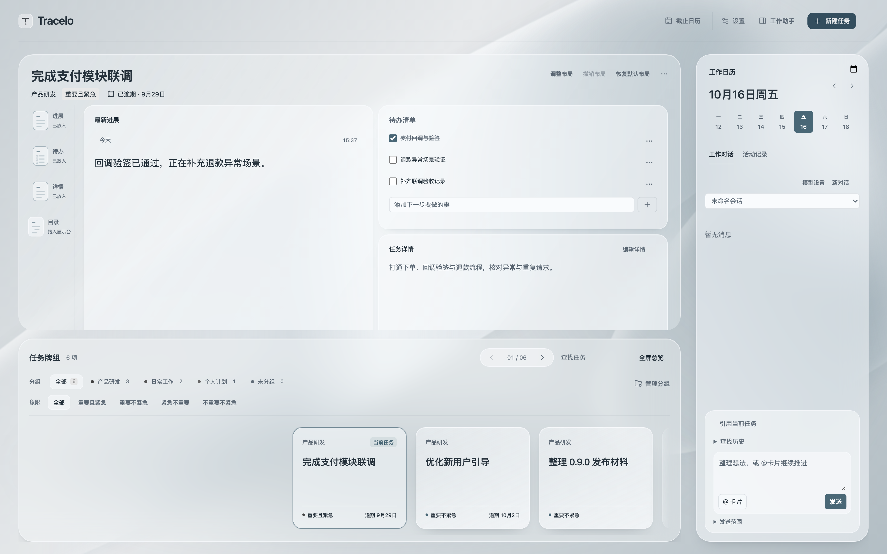
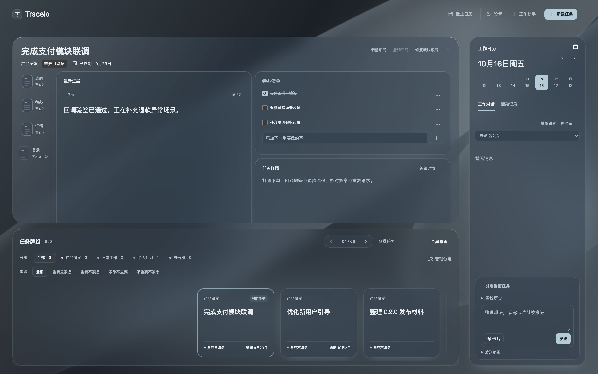
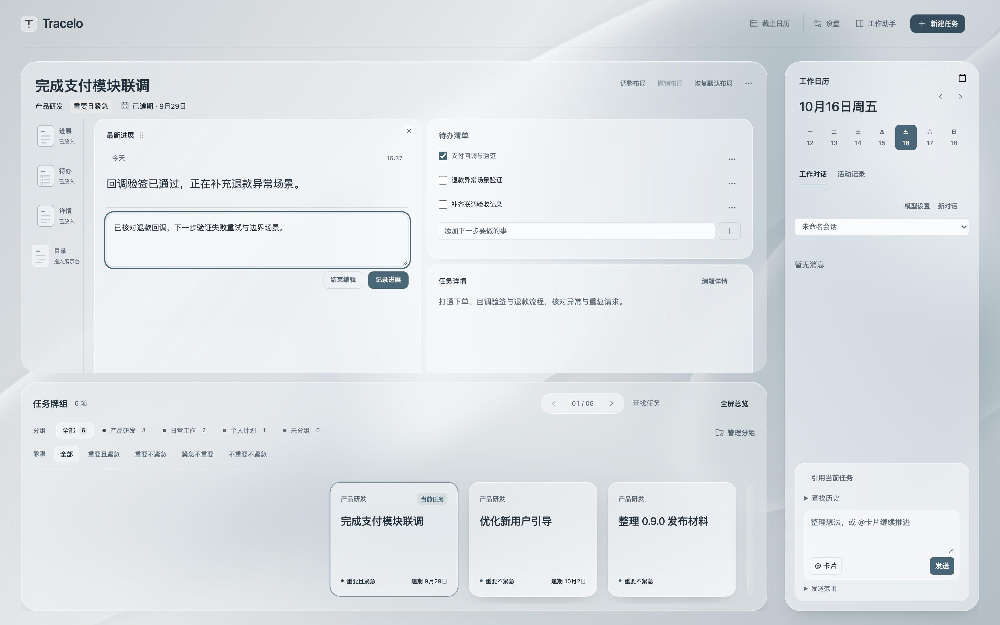
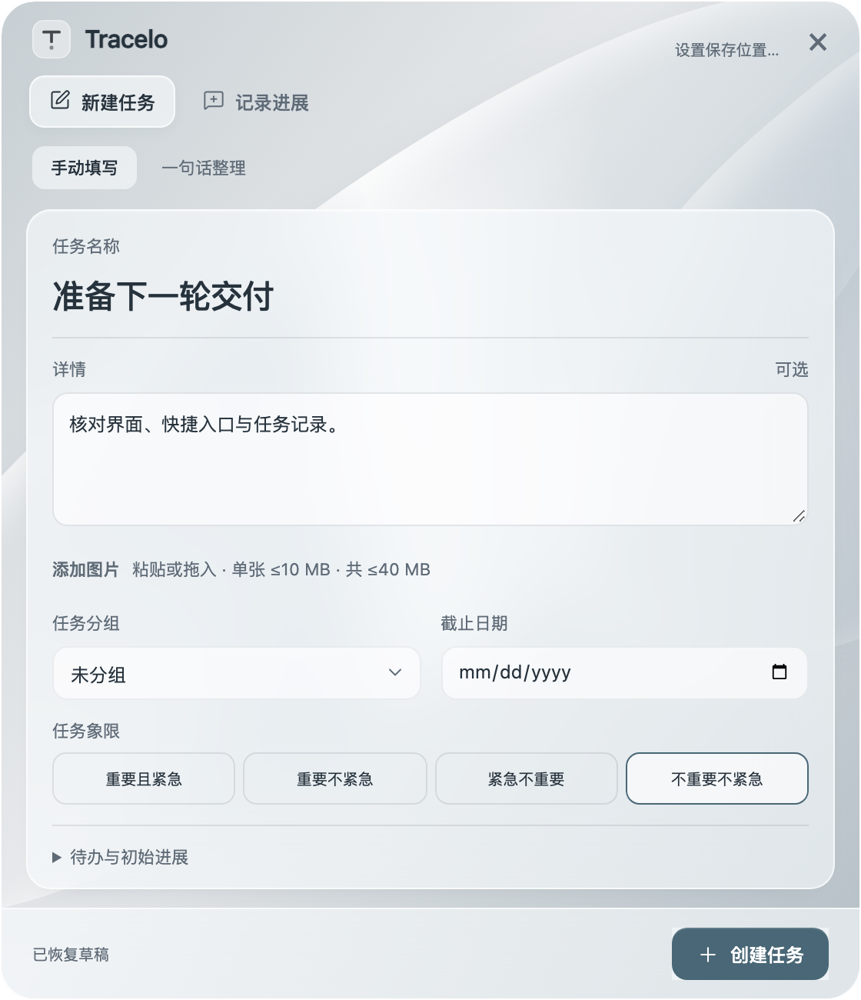
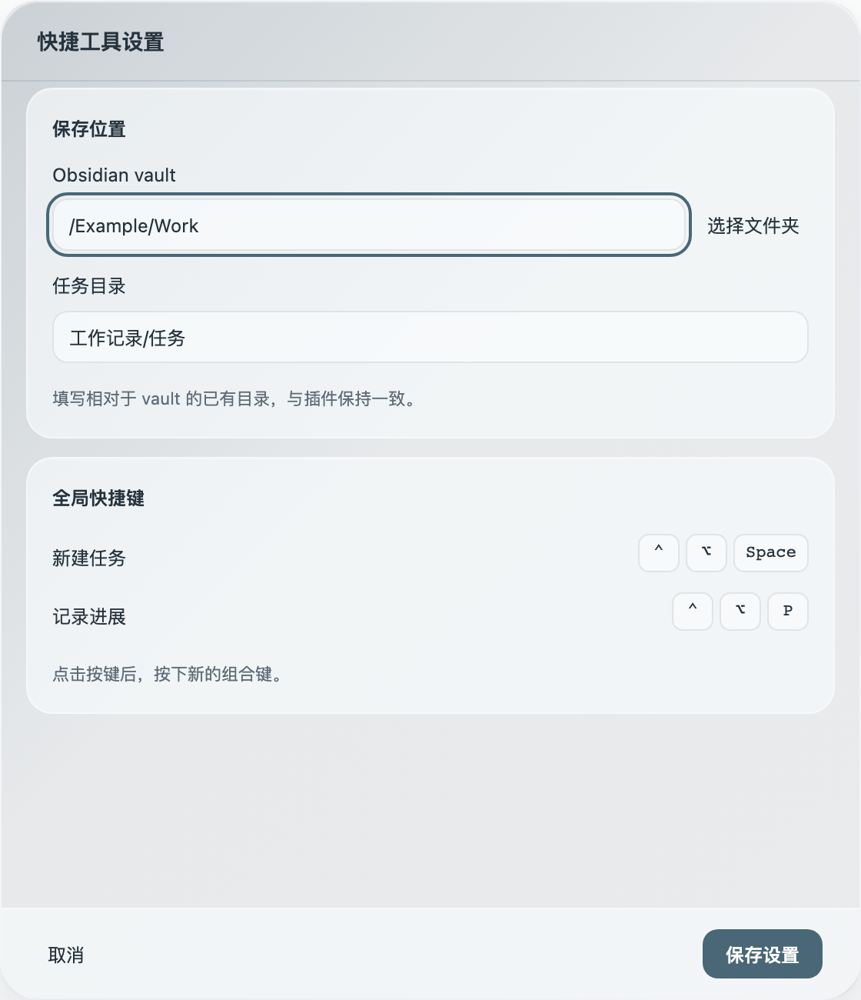

# Tracelo 1.0.1

本版整合 1.0.0 发布后的展示台操作、设置与品牌适配，插件和 macOS／Windows 快捷工具使用同一版本。

- 展示台的标题和正文用于阅读；通过“记录进展”进入编辑，“结束编辑”与提交位于同一行。待办可独立新增、编辑、勾选，关闭进展编辑保留草稿。
- 直接拖动视图标题调整位置；在边缘加行列，拖动分界调整实际尺寸。可移出全部视图并重新加入，移出只影响展示，保留内容与草稿；支持撤销、恢复默认和 Esc 取消缩放。
- 宽窗口上方任务阅读区独立滚动，下方牌组对齐底部；背景和动效归入设置，顶栏操作统一为图标加文字。
- 插件设置、模型设置及桌面工具保存位置／快捷键设置统一银灰风格；品牌标记、文字层级和操作图标适配深浅色及宿主字体。

## 当前实现例图

例图来自本版生产组件和隔离样本，不是设计稿或正式任务数据。

## 下载与升级

从本页附件下载 `Tracelo-1.0.1-obsidian.zip`、`Tracelo-Capture-1.0.1-macos-universal.zip` 或 `Tracelo-Capture-1.0.1-windows-x64.zip`，使用 `SHA256SUMS.txt` 核验。

插件替换 `main.js`、`styles.css`、`manifest.json` 后重载；保留 `data.json`、任务目录及草稿。快捷应用退出后替换并重开，vault／任务目录应与插件一致。本版不改变正式任务存档协议，布局与外观继续存于插件配置。

macOS 包为 Universal、ad-hoc 签名，未做开发者公证；Windows x64 包自带 .NET，需 WebView2。系统来源提示、安装与配置见[桌面说明](../../desktop/README.md)。

## 验证与范围

本地回归、三平台候选与正式工作流、附件校验和安装结果记录在[发布验收](../validation/2026-10-16-release-101.md)。自动原生窗口检查不等同于真实中文候选窗、听写、多屏／全屏及完整 Windows 人工设备矩阵。

负责人／行动提醒和任务菜单精简仍为未确认提案，不在本版新增功能中。已有七天使用观察继续保留。
