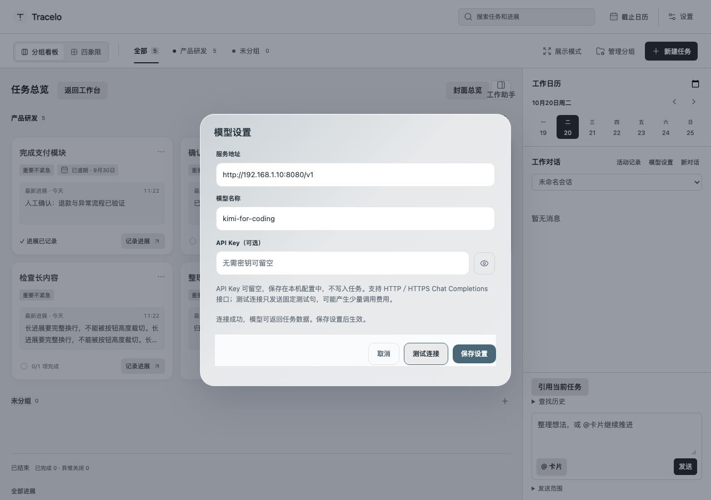

# Tracelo 1.0.2

本版让模型设置兼容无需认证、使用自定义密钥的自建服务；Obsidian 插件和 macOS／Windows 快捷工具同步更新。

- API Key 可留空，不检查长度、前缀或字符格式；填写后作为 Bearer 凭证发送，空密钥不发送 Authorization。
- 支持 HTTP／HTTPS Chat Completions 兼容服务，自定义端口和 API 子路径继续可用。
- 旧密钥文件保持兼容；设置中可“清除旧密钥”，清空并保存后使用无密钥请求。密钥默认隐藏，原配置和草稿保留。

## 下载与升级

从本页下载 `Tracelo-1.0.2-obsidian.zip`、`Tracelo-Capture-1.0.2-macos-universal.zip` 或 `Tracelo-Capture-1.0.2-windows-x64.zip`，使用 `SHA256SUMS.txt` 核验。

插件替换 `main.js`、`styles.css`、`manifest.json` 后重载；保留 `data.json`、任务目录及草稿。快捷程序退出后替换并重新打开，vault／任务目录应与插件一致。本版不改变正式任务存档协议。

macOS 包为 Universal、ad-hoc 签名，未做开发者公证；Windows x64 包自带 .NET，需 WebView2。系统来源提示、安装与配置见[桌面说明](../../desktop/README.md)。

本轮验证、三平台候选与正式工作流、附件核验和本地安装见[发布验收](../validation/2026-10-20-release-102.md)。没有使用用户真实凭证或模型服务做发布测试；自动原生窗口检查不等同于中文候选窗、听写、多屏／全屏及完整人工设备矩阵。
