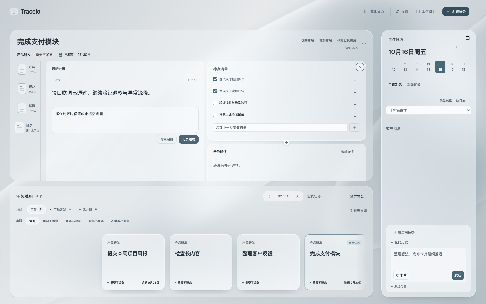

# 展示台视图操作与 Mockup 对齐

2026-10-16。用户反馈多项展示台操作与原型不一致，且缺少删除视图按钮。本轮在 `codex/stage-interaction-parity` 修复；保留同一工作区内独立待办／进展操作和设置统一的并行修改。公开的 1.0.0 标签及 Release 不变，本记录不代表再次发布。

## 修复与边界

- 左侧改为小卡片缩略图加模块名称，悬停延迟预览；单击只定位已放入的视图，拖动才加入。预览过滤编辑控件和未提交草稿，目录保留文件名称。
- 已放入的卡片可直接拖动标题；拖到卡片左右边缘插列，主体上下半部插行。落点标明新列／新行，分界线悬停显现加号，插入与调整尺寸各有操作区域。
- 卡片右上角悬停或键盘聚焦显示“×”，名称明确为“删除进展／待办／详情／目录视图”。只移出展示区，不删除正式内容、草稿或原有编辑节点；允许移出全部视图，再由缩略图或加号放回。默认及自定义布局仍按任务保存。
- 重复加入移动原视图；拖回自己上下边界不改变顺序。同列向后移动按移出后的索引计算，避免落错行。
- 修正仅保存行高比例、实际卡片高度却不变的问题：测量正文自然高度，再确定能容纳正文的画布高度并应用比例。新增默认均分；手动拖动改变实际高度，长内容完整呈现，整个阅读区可滚动。Esc 或指针取消恢复调整前尺寸。
- 调整布局入口移入任务标题操作区；保留当前任务撤销、恢复默认、保存失败提示和中文组合输入保护。未擅自精简右上任务业务菜单，另见[菜单评估](2026-10-16-workbench-edit-review.md)。

## 验证

均为本轮当前生产组件或构建，交互数据采用隔离夹具，不写正式任务。模型与浏览器回归先复现缺陷，再修正验证。

| 检查 | 结果与范围 |
| --- | --- |
| `npx vitest run --exclude '**/.local/**'` | 15:08 执行，152 通过、2 跳过；排除并行交付的 `.local` 快照，避免重复统计。跳过项需 .NET SDK。 |
| `npm run build` | 类型检查及生产构建通过。 |
| `npm run test:workbench` | 工作台、模块布局、独立编辑及视图交互四套通过；本轮新增 28 项，见[结果](assets/stage-interactions/result.json)。 |
| `npm run test:layout` | 完整布局与卡片交互套件通过。并行设置修改后的旧导航断言已同步，再运行通过。 |
| `npm run test:presentation` | 展示模式、动效、焦点等已有回归通过。 |
| 快捷进展、共享创建表单浏览器检查 | 直接进展及 macOS／Windows 桥接的草稿、组合输入、失败重试与短屏按钮可达通过。 |
| `bash desktop/package-macos.sh` | Universal 构建、签名与隔离原生 WebKit 冒烟通过。不能代替实体全局快捷键及真实中文候选窗。 |

28 项包含真实鼠标标题拖动、卡片边缘插列、同列排序与自身边界、实际行高均分与调整、悬停删除、空布局保存与草稿节点恢复、分界线加号、移动而不复制、预览过滤、Esc 取消、组合输入保护，以及 1728／1280／390 宽度的溢出与键盘入口。拖拽测试使用当前可见的卡片边缘；长内容位于整体滚动区内，不以屏幕外的卡片中心作为鼠标落点。

日志保留于本机 `.local/stage-interaction-parity/`；截图已检查稳定状态，均为合成内容：

[宽窗口](assets/stage-interactions/light-1728.png)、[深色短窗口](assets/stage-interactions/dark-1280.png)、[窄窗口](assets/stage-interactions/light-390.png)。

## 本地交付

15:21（UTC+08:00）最终核对通过：插件位于本项目 `.obsidian/plugins/work-timeline/`，三件套与当前构建逐文件 SHA-256 一致；本机 `/Applications/Tracelo Capture.app` 与当前 Universal 打包目录逐文件一致，已更新并重启。并行工作区最后安装的产物与本轮最新构建相同，没有用旧隔离快照覆盖并行功能。正式任务／附件字节、原配置、快捷偏好与所有草稿均保留。备份在本机 `.local/stage-interaction-parity/install/install-backup/`，含私人配置，不上传；核对日志为 `.local/stage-interaction-parity/install-verify-final.log`。

15:22～15:23 在真实 `Tracelo - WorkAssistant - Obsidian 1.14.4` 复核：最新缩略图与已放入状态、标题的拖动提示、删除进展／待办／详情视图按钮及“保留内容”说明均存在。进入“调整布局”后实际截图可见卡片右上角“×”、行列加号与分隔条；随后退出辅助状态。此次实机未删除视图或提交任务，真实拖放、恢复及写盘失败由隔离生产交互套件覆盖，没有冒称逐项实机通过。

实体快捷键、真实中文候选窗、多屏／全屏与 Windows 原生人工矩阵本轮未完整复验，保留既有验收边界。快捷程序实际窗口的 CUA 读取超时见[并行安装记录](2026-10-16-workbench-settings.md)。本轮修复未提交、推送或重新发布，公开 1.0.0 不包含这些发布后的源码改动。
