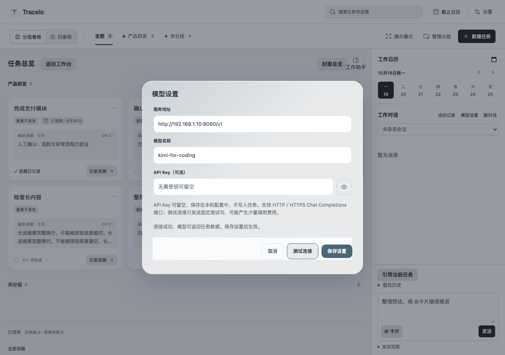

# 2026-10-19 · 自建模型可选密钥

用户明确要求自建服务可使用 HTTP，密钥是否填写、长度和格式均不限制。本轮基于 main 的 `f87edb7` 开发，保留无关未跟踪的 harmony 目录。1.0.1 已发布标签未改；本轮为其后的本地开发构建，尚未提交、推送或发布。

以上为10月19日交付时状态。用户随后授权发布1.0.2，后续三平台、远端及正式包安装结果另见[10月20日发布验收](2026-10-20-release-102.md)，不改写本页当日验证范围。

## 行为与范围

插件及共享设置页取消 API Key 的必填、4096 字符上限和格式校验；插件工作对话、一句话整理、macOS Swift 和 Windows C# 请求层同步接受空密钥或任意凭证文本。空密钥不发送 Authorization，有值时作为 Bearer 凭证发送，由服务端决定是否接受。HTTP／HTTPS、自定义端口及 API 子路径支持保持有效。

旧密钥文件仍兼容读取，保留非空旧路径的绝对路径要求，取消凭证长度和格式检查；旧的标记行、引用包裹及 Markdown 中唯一的旧式凭证仍可读取。没有编辑密钥时保留旧路径，编辑／清空或使用“清除旧密钥”后保存可转为无密钥调用。没有自动修改用户已有地址、凭证或正式任务。

## 验证

执行时间为2026-10-19 09:20～09:30（+08:00）。[机器结果](assets/optional-model-key-20261019/verification.json)记录时间和日志摘要；完整日志在本机 `.local/optional-key-20261019/`。

| 检查 | 结果与范围 | 本机日志 |
| --- | --- | --- |
| 回归先失败 | TS 新增空、短、特殊字符和超长凭证用例被旧校验拒绝；Swift 空密钥报“请填写 API Key”；浏览器仍有 maxlength=4096。修复后通过 | red-ts.log、red-swift.log、red-browser.log |
| `npm run test:smart` | 25项单元通过；插件及 mac／Windows 模拟桥接均可测试连接、保存空密钥，短密钥、含空格／特殊字符及5000字符的输入不被拦截；插件空密钥请求不含 Authorization | smart.log |
| `npm test`／`npm run build` | 152项通过、2项.NET跳过；类型检查和生产构建通过 | unit.log、build.log |
| 工作对话浏览器 | 日历、引用、确认、草稿、失败与取消回归通过 | conversation.log |
| Swift／macOS | 10项核心测试通过，配置与旧文件额外覆盖70000字符；Universal两架构、签名及真实WebKit表单／设置和原子提交冒烟通过 | swift-core.log、macos.log |
| 安装版 HTTP 请求 | 真实WebKit → Swift URLSession → 本机 HTTP 服务通过；服务端确认没有 Authorization；仅固定虚构输入，在隔离临时vault完成确认创建与进展草稿检查 | native-http.json、native-http.log |
| 设置布局 | 查看当前生产组件截图；mac／Windows共享页在宽560及390短窗口的保存按钮可达、无横向溢出，含旧密钥清除按钮；最终桥接复跑通过 | desktop-final.log |
| 本地安装与真实宿主 | 三件套／应用树哈希与构建一致，正式任务与附件、插件配置、偏好和草稿保留。实际WorkAssistant Obsidian 1.14.4重载后，设置显示“API Key（可选）”、空密钥说明及清除旧密钥入口；取消退出，不改用户配置 | install-verify.log、install-after-host.log |

## 本地交付与边界

已更新本项目 `.obsidian/plugins/work-timeline/` 的 `main.js`、`styles.css`、`manifest.json`，替换并重启 `/Applications/Tracelo Capture.app`；实际宿主已重载，快捷程序进程运行。完整安装前备份位于 `.local/optional-key-20261019/install/install-backup/`，含私人配置和草稿，只留本机。恢复时只按需回退程序文件，不能覆盖后续任务／配置编辑。

Windows C# 同步实现和等价用例已修改，本机没有.NET SDK和Windows设备，未执行其编译或原生请求；模拟桥接不替代原生通过。没有调用用户模型服务、验证真实凭证或修改既有模型配置；网络夹具成功不表示所有服务均可达。实体快捷键、全焦点、真实IME、听写和多屏矩阵不在本轮通过范围。
