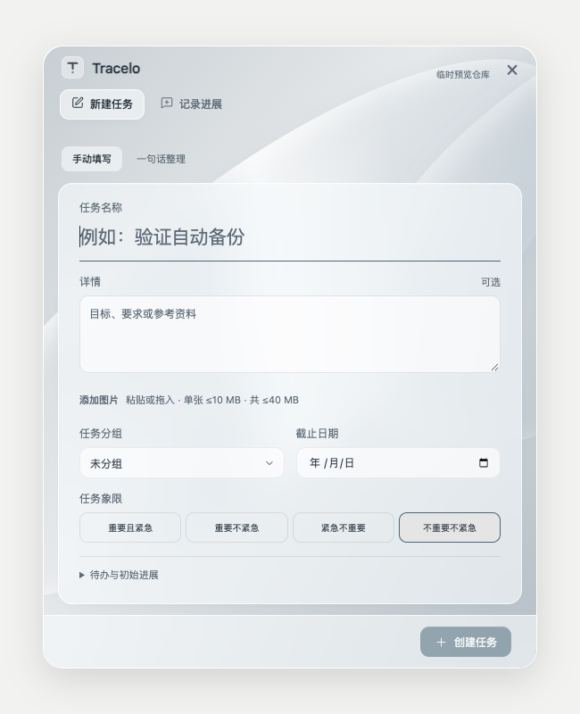
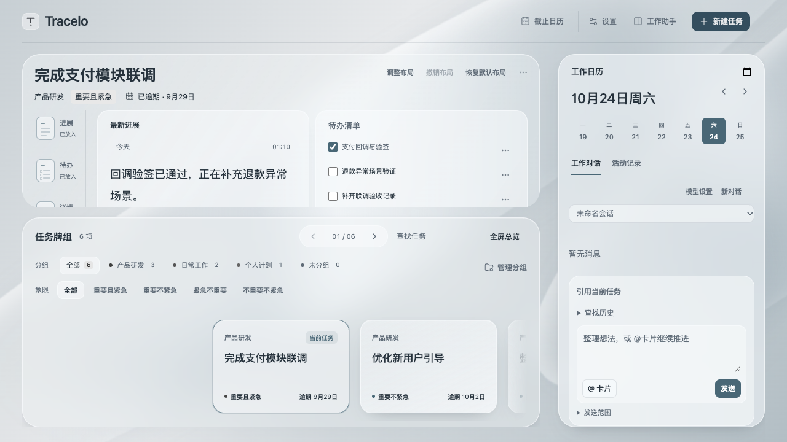
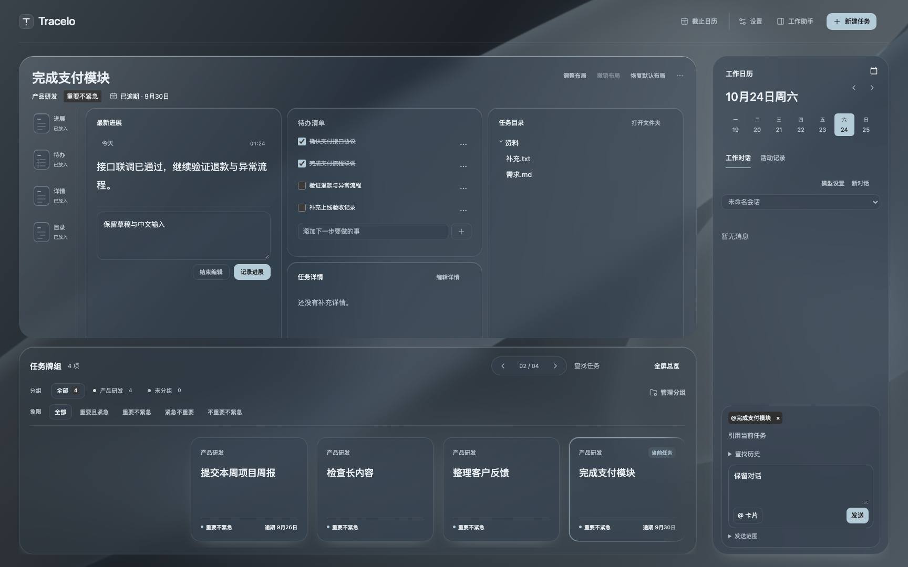

# 2026-10-24 · 使用流程验证与界面统一

用户要求完整验证使用流程，并再做一轮美化与统一。本轮基于 main 的 1.0.2，保留无关 `harmony/`，沿用已确认的银灰工作台与模块布局，不扩展功能或改变任务协议。

## 修改与取舍

- 将新建／直接进展共享表单的标签、磨砂阅读面、输入、四象限和按钮材质从桌面宿主样式移入根样式，插件与 macOS／Windows 共用。统一普通弹窗和图片预览的主题底色、圆角及字体；保留每个表单的结构与独立草稿。
- 缩短工作侧栏的非内容间距，让消息区按剩余高度伸缩。650／720px 高窗口默认可直接看到发送按钮；展开历史查询后仍可滚动到达，日历、日期切换和截止信息继续保留。
- 总览中的工作助手按钮保持图标与文字同排；快捷页新建／进展标签统一间距；深色对话引用明确使用主题文字色，避免继承宿主黑字。
- 没有删产品文案。独立静态评审建议去掉重复“已放入”，但它仍用于表达模块当前状态，暂保留。短窗口任务区继续独立滚动，以保留下方牌组导航；既有工作台用例验证滚动后编辑与目录入口可达，不用缩小正文换取全屏塞入。

## 本轮证据

[机器结果](assets/flow-polish-20261024/checks.json)记录日志完成时间及摘要。[完整检查日志](assets/flow-polish-20261024/check-final.log)对应 `npm run check`：152 单元通过，2 项 Windows .NET 因本机缺 SDK 跳过；类型检查／生产构建和全部浏览器套件通过。覆盖：

| 流程 | 结果与范围 |
| --- | --- |
| 新建与图文 | 只填名称、全部字段、四象限、截止、图片多选／粘贴／拖入、失败与重试、取消恢复、短窄窗口底部操作 |
| 进展与任务 | 选择／切卡、独立待办、详情、完整历史、完成／异常关闭／重开、排序／跨区、文件外部编辑与异常保护 |
| 工作台与阅读 | 模块拖入／移动／删除／尺寸、分组与四象限、总览／展示、100 卡、阅读锚点、独立滚动、减少动态效果 |
| 对话与智能整理 | 有限引用、确认提议、过期写入、历史来源、失败／取消／迟到回调、重试身份、会话／草稿恢复；模型使用隔离夹具 |
| 桌面共享表单 | macOS／Windows 模拟桥接的创建、直接进展、设置、失败保留、回执与隐藏窗口恢复 |
| 外观 | 五主题、宿主与独立明暗、窄／短窗口、布局与现有缩放矩阵；95 项辅助主题检查通过 |

短窗口问题先由[新增回归失败日志](assets/flow-polish-20261024/viewport-red.log)复现，再修复通过；`tests/workbench-viewport.browser.mjs` 已接入 `test:workbench`。整套通过后补充的标签排版与深色引用文字改动，分别重跑共享表单、工作台、工作对话定向检查通过，未无故重复完整套件。

首轮并发检查曾出现 Swift 冷构建、浏览器加载及模拟桌面设置点击超时；原命令定向复验通过，未改限时或放宽断言。精修中主题回归捕获选中底色、按钮形状和预览底色差异，已修产品而非放宽测试。首次 `?dark` 预览仅改变宿主，独立外观仍是浅色，未计为深色证据；下图来自明确切换插件独立深色的本轮生产测试。

已完成一轮独立静态评审（不打分），修正标签图标间距；主 Agent 已查看以上实际生产组件截图。截图与模拟宿主不能替代真实系统输入法、听写或动态效果人工验收。

## 本地交付

[安装核验](assets/flow-polish-20261024/installation.json)通过：插件三件套已同步到本项目 `.obsidian/plugins/work-timeline/`，macOS Universal 包已替换 `/Applications/Tracelo Capture.app` 并重启。安装树与最终构建哈希一致，正式任务／附件逐文件哈希、既有设置、桌面偏好和全部草稿保持不变。

真实 WorkAssistant Obsidian 已通过命令面板重载，打开新建表单确认新标签、圆角阅读面与统一按钮生效，再关闭且未提交。真实宿主截图含正式任务，留在本地不纳入工程公开证据。Swift 10 项、Universal 构建／签名及原生 WebKit 见[原生结果](assets/flow-polish-20261024/native/checks.json)；[安装版隔离冒烟](assets/flow-polish-20261024/native/installed-native.log)再次通过创建、完整存档原子写入／幂等重试、表单深浅色及底部焦点检查。

全局快捷键尝试后，CUA 读取安装版快捷应用超时；进程存在，但创建／进展全局快捷窗口及返回焦点未取得可见证据，不能计为通过。自动原生冒烟不注册真实快捷键，也不替代该项。

安装前备份位于本机 `.local/flow-polish-20261024/install/install-backup/`，包括插件、任务材料、桌面应用、偏好和草稿，含私人配置，不上传。

本轮不提交、不推送、不发布；1.0.2 版本号不变。Windows 原生、真实中文候选窗、麦克风听写、多屏／全屏和完整实体快捷键矩阵未计为通过，后续边界保留在 [task.md](../../task.md)。
