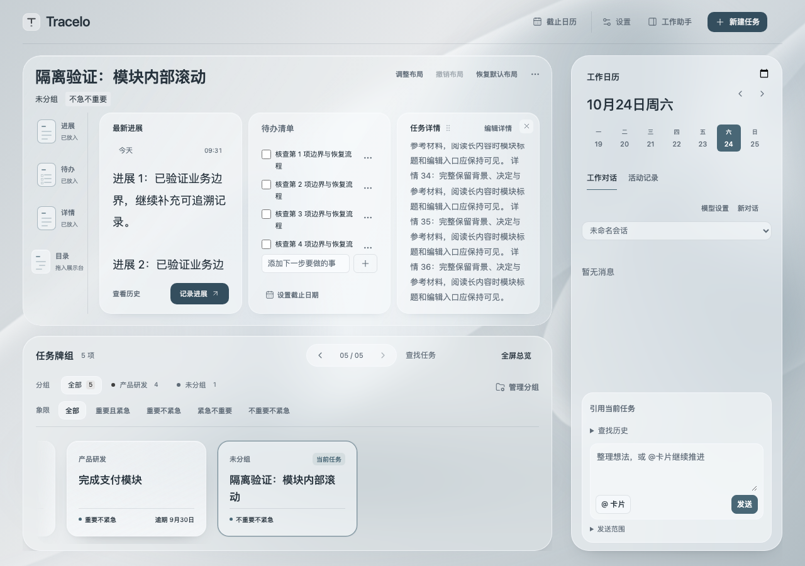
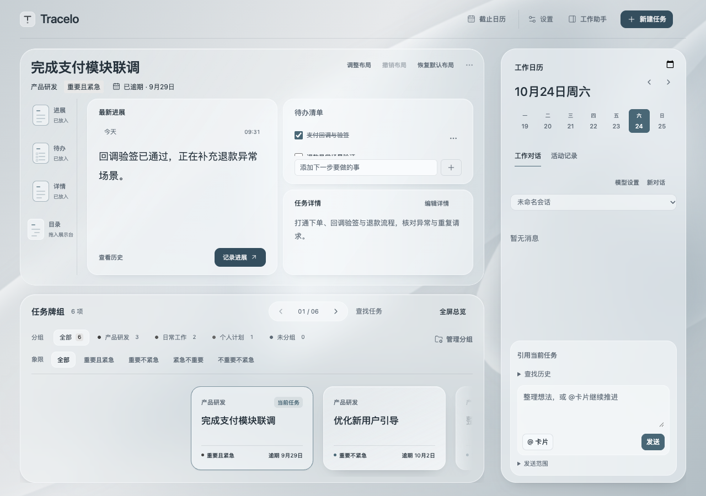

# 2026-10-24 · 展示台模块内部滚动

用户指出长详情会撑高内部卡片，导致整个展示区滚动，提出限制模块高度并在卡片内滚动。本轮沿用当前银灰工作台，改动只作用默认展示台；保留上一轮界面精修和无关 harmony，不改变展开看板、存档协议或正式任务内容。

## 交互与视觉

- 外框可用空间决定画布高度，继续应用已有行列比例；不再用最长正文反推整个展示台高度。进展正文、待办列表、详情与目录各有可聚焦的滚动区，标题、记录／新增／编辑等操作留在正文外。
- 同任务重绘与布局移动保留各模块阅读位置和原输入节点。异步目录刷新期间再次进入详情编辑，仍保留待恢复位置；用户主动操作可取消迟到的恢复。新进展回到新正文顶部，任务之间不串阅读位置。
- 不靠缩字号或删内容适配。正文至少保留两行量级的阅读空间；多行比例、编辑控件或极矮窗口空间不足时仍允许外层兜底滚动。窄窗口自然上下排列。
- 未删界面文案，未引入额外动画。本次为局部交互调整，由主 Agent 查看实际生产组件截图，未另做视觉评分。代码与回归由另一 Agent 独立核对。

## 验证

[旧实现红灯](assets/stage-scroll-20261024/red.log)实测：外框高430px，三列模块被长内容撑至3414px。新增回归先失败后修复，已加入 `test:workbench`。

[完整工作台回归](assets/stage-scroll-20261024/workbench-final.log)与[类型／生产构建](assets/stage-scroll-20261024/build-final.log)通过。本轮只运行受影响套件，没有把上一轮152单元及完整check算作本轮重跑。新回归[结果](assets/stage-scroll-20261024/result.json)覆盖：

- 1280×900的三列长正文保持在外框内；真实滚轮只移动当前正文，标题不移位、编辑入口实际命中。
- 720／650高窗口自适应，最后一行仍可读；390宽自然顺排、无横向溢出。
- 滚到长清单末尾勾选后，各模块阅读位置、进展草稿和输入节点保留；调整列宽后原节点与位置保留。
- 80项目录异步刷新时再次进入详情编辑，列表恢复仍保持480px阅读位置；目录树语义与草稿保留。
- 既有28项拖动／均分行高／分隔条／删除与恢复／Esc／IME事件回归，以及主题、工作对话、总览、目录错误、失败重试与独立编辑通过。

补充检查曾复现异步目录第二次重绘丢位置，已修复待恢复位置的传递。原编辑检查曾跨两个布局帧分别取按钮位置产生一次对齐误报；同帧输出确认两按钮同排后，改为同帧读取两者尺寸，原断言阈值不变。窗口变化过程不等于稳定态视觉。

## 本地交付

已将当前三件套安装到本项目 `.obsidian/plugins/work-timeline/`，重载真实 WorkAssistant Obsidian。实际三列展示台中将长详情滚到底部，确认只有详情正文移动，标题、编辑入口、其他模块及外框保持固定，底部圆角与内边距完整。实机截图包含私人任务和对话，仅保留在本机 `.local/stage-scroll-20261024/`，本页使用隔离夹具截图。

macOS快捷程序已更新至 `/Applications/Tracelo Capture.app` 并重启。最终Universal、严格签名及原生WebKit隔离冒烟见[结果](assets/stage-scroll-20261024/native/verification.json)。原生冒烟包含共享表单／焦点、完整存档原子写入及幂等重试，不注册实体快捷键。

[安装核验](assets/stage-scroll-20261024/installation.json)确认插件三件套与应用树均匹配本轮构建，正式任务／附件逐字节不变，既有设置、桌面偏好和全部草稿保留。安装前备份在本机 `.local/stage-scroll-20261024/install/install-backup/`，不上传。

本轮没有Windows设备、真实中文候选窗、麦克风／多屏完整复验；此前快捷窗口CUA读取超时仍是未测边界。本轮不提交、推送或发布，版本仍为1.0.2。
